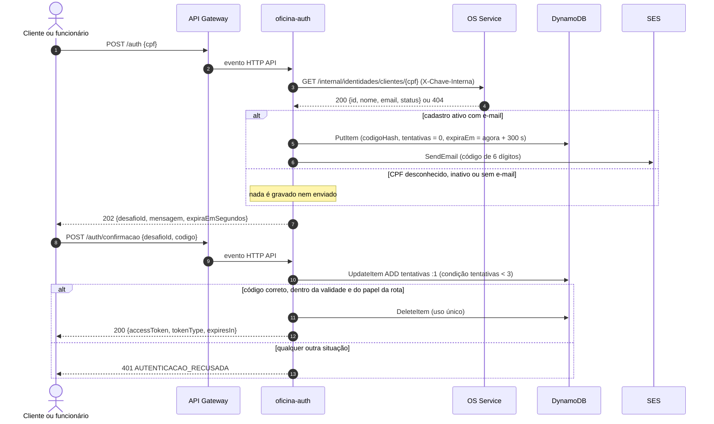

# oficina-auth-lambda

Função serverless de autenticação por CPF com segundo fator por e-mail do sistema de gestão de oficina mecânica, desenvolvida no Tech Challenge da PosTech FIAP (Arquitetura de Software).

| Repositório | Conteúdo |
|---|---|
| [tech-challenge-1](https://github.com/Guilherme-Fumagali/tech-challenge-1) | OS Service: cadastro, catálogo, ordens de serviço e orquestração da saga |
| [oficina-billing-service](https://github.com/Guilherme-Fumagali/oficina-billing-service) | Orçamento e pagamento |
| [oficina-execution-service](https://github.com/Guilherme-Fumagali/oficina-execution-service) | Execução do diagnóstico e do reparo |
| **oficina-auth-lambda** | Autenticação por CPF com segundo fator (este repositório) |
| [oficina-infra-k8s](https://github.com/Guilherme-Fumagali/oficina-infra-k8s) | Rede, EKS, NLB, API Gateway e New Relic |
| [oficina-infra-db](https://github.com/Guilherme-Fumagali/oficina-infra-db) | RDS da Fase 3, mantido como registro |

## Propósito

A função valida o CPF, consulta a identidade do cliente ou do funcionário no OS Service e conduz o login em duas etapas: a primeira envia um código de uso único ao e-mail cadastrado; a segunda confere o código e emite o JWT consumido pelas APIs protegidas.

Na Fase 4, a função deixou de ler as tabelas `clientes` e `funcionarios` do banco do OS Service. A consulta passou a usar o endpoint interno `GET /internal/identidades/...` do próprio serviço, pois nenhum serviço acessa o banco de outro. O segundo fator trata o débito técnico DT-06 (autenticação apenas por CPF), registrado na Fase 3.

## Arquitetura

```
                                  Internet
                                      │
                    ┌─────────────────▼─────────────────┐
                    │           API Gateway             │  HTTP API
                    └─────┬───────────────────────┬─────┘
 quatro rotas /auth       │                       │ rotas /api
                          │                       │ protegidas
        ┌─────────────────▼─────────────────┐  ┌──▼───────────────────┐
        │ AuthFunction (na VPC)             │  │ AuthorizerFunction   │
        │ consulta o cadastro, envia o      │  │ (fora da VPC)        │
        │ código e emite o JWT              │  │ valida o JWT         │
        └─────┬───────────┬───────────┬─────┘  └──────────────────────┘
              │           │           │
              ▼           ▼           ▼
         OS Service   DynamoDB       SES
           via NLB  via endpoint   via NAT
```

| Função | Responsabilidade | Rede | Limites |
|---|---|---|---|
| `oficina-auth-<ambiente>` | atende as quatro rotas de autenticação: valida o CPF, consulta o OS Service, grava o desafio, envia o código e emite o JWT na confirmação | dentro da VPC, para alcançar o NLB interno | 512 MB, 10 s |
| `oficina-authorizer-<ambiente>` | valida o JWT das rotas protegidas; carrega apenas o segredo do JWT | fora da VPC | 256 MB, 5 s |

## Fluxo em duas etapas



As rotas de funcionário (`/auth/funcionarios` e `/auth/funcionarios/confirmacao`) seguem o mesmo fluxo, consultam `/internal/identidades/funcionarios/{cpf}` e emitem o token com papel `FUNCIONARIO`. A mesma função atende as quatro rotas e as distingue pelo `routeKey` do evento; uma rota diferente recebe 404.

## Contrato da API

### `POST /auth` e `POST /auth/funcionarios`

```json
{ "cpf": "529.982.247-25" }
```

**202 Accepted**

```json
{
  "desafioId": "6f1c0e3e-5a4b-4c2d-9e8f-0123456789ab",
  "mensagem": "Se o CPF estiver cadastrado e ativo, um código foi enviado ao e-mail registrado.",
  "expiraEmSegundos": 300
}
```

| Status | Código | Situação |
|---|---|---|
| 202 | — | qualquer CPF válido, cadastrado ou não |
| 400 | `CPF_INVALIDO` | corpo ausente ou inválido, CPF malformado ou com dígito verificador incorreto; o OS Service não é consultado |
| 503 | `SERVICO_INDISPONIVEL` | OS Service fora do ar, lento (mais de 2 s) ou com resposta inesperada, ou falha no envio do e-mail; nenhum token é emitido |
| 500 | `ERRO_INTERNO` | falha não prevista, como a gravação no DynamoDB, sem detalhes na resposta |

### `POST /auth/confirmacao` e `POST /auth/funcionarios/confirmacao`

```json
{ "desafioId": "6f1c0e3e-5a4b-4c2d-9e8f-0123456789ab", "codigo": "042137" }
```

**200 OK**

```json
{ "accessToken": "eyJhbGciOiJIUzI1NiJ9...", "tokenType": "Bearer", "expiresIn": 900 }
```

| Status | Código | Situação |
|---|---|---|
| 400 | `REQUISICAO_INVALIDA` | corpo ausente ou inválido, ou `desafioId`/`codigo` em branco |
| 401 | `AUTENTICACAO_RECUSADA` | desafio inexistente ou em formato inválido, vencido, já utilizado, de outro papel, código incorreto ou tentativas esgotadas |
| 500 | `ERRO_INTERNO` | falha não prevista, sem detalhes na resposta |

### Claims do token

| Claim | Conteúdo |
|---|---|
| `sub` | UUID do cliente ou do funcionário (o CPF não é usado como identificador, para não circular nos logs) |
| `cpf` | CPF normalizado, com 11 dígitos |
| `nome` | nome do cliente ou do funcionário |
| `role` | `CLIENTE` ou `FUNCIONARIO` |
| `iss` | `oficina-auth` |
| `exp` | 900 segundos após a emissão |

## Anti-enumeração e limite de tentativas

- **Primeira etapa:** cadastro ativo, CPF desconhecido, cadastro inativo ou bloqueado e cadastro sem e-mail recebem o mesmo status, os mesmos cabeçalhos e os mesmos campos, com a mesma mensagem. Nos três últimos casos nada é gravado nem enviado, e o `desafioId` devolvido é aleatório e não existe na tabela.
- **Segunda etapa:** toda recusa devolve o mesmo 401, com o mesmo corpo. O motivo (`desafio_invalido`, `desafio_indisponivel`, `expirado`, `codigo_incorreto`, `papel_divergente`, `desafio_ja_utilizado`) fica apenas no log.
- **Código:** 6 dígitos gerados com `SecureRandom`. A tabela guarda somente o HMAC-SHA256, em hexadecimal, de `desafioId:codigo`, calculado com o segredo `otp-segredo`; a comparação é feita em tempo constante.
- **Tentativas:** cada confirmação consome uma tentativa antes da comparação, por meio de um `UpdateItem` condicional (`ADD tentativas :1` com a condição `attribute_exists(desafioId) AND tentativas < 3`). Com isso, mesmo sob requisições simultâneas, ocorrem no máximo três comparações por desafio. A terceira tentativa errada apaga o desafio.
- **Validade:** 5 minutos, verificada pelo código (`expiraEm < agora` resulta em 401). O TTL do DynamoDB remove o item depois, sem prazo garantido.
- **Uso único:** o código correto apaga o desafio com `DeleteItem` (`ReturnValues=ALL_OLD`), e o token só é emitido se a remoção encontrou o item; duas confirmações simultâneas não geram dois tokens.
- **Papel:** um desafio criado em `/auth` só é confirmado em `/auth/confirmacao`, e o de funcionário apenas na rota de funcionário. O papel do token vem do desafio.
- **Logs:** resultado, papel, CPF limitado aos três últimos dígitos, UUID da identidade e os oito primeiros caracteres do `desafioId`. O código, o hash e o e-mail não são registrados.

## Dependência do endpoint interno do OS Service

| Item | Valor |
|---|---|
| Endpoints | `GET http://<nlb-dns>/internal/identidades/clientes/{cpf}` e `GET http://<nlb-dns>/internal/identidades/funcionarios/{cpf}` (contrato da SPEC-09 §5) |
| Autenticação | cabeçalho `X-Chave-Interna` com o valor de `/oficina/<ambiente>/chave-interna` |
| Resposta | 200 `{id, nome, email, status}`; 404 quando o CPF não está cadastrado |
| Regra | autentica apenas `status = ATIVO` com e-mail preenchido |
| Tempo limite | 2 s para conexão e 2 s para a resposta, HTTP/1.1 |
| Falhas | 401 (chave recusada), 5xx, tempo esgotado, falha de conexão ou corpo inválido resultam em 503, sem desafio e sem token |

A rota `/internal/**` não é publicada no API Gateway: a função chega a ela pela VPC, no listener 80 do NLB interno. O endpoint é implementado pelo OS Service no repositório `tech-challenge-1`; enquanto ele não estiver implantado, a primeira etapa responde 503.

## Parâmetros, variáveis e recursos

### Parâmetros do SSM (`/oficina/<ambiente>/`)

| Parâmetro | Tipo | Usado por | Origem |
|---|---|---|---|
| `jwt-secret` | SecureString | as duas funções | `oficina-infra-k8s` |
| `chave-interna` | SecureString | `oficina-auth` | `oficina-infra-k8s` |
| `otp-segredo` | SecureString | `oficina-auth` | `oficina-infra-k8s` |
| `nlb-dns` | String | `oficina-auth` | `oficina-infra-k8s` |
| `private-subnet-ids`, `lambda-security-group-id` | String | template | `oficina-infra-k8s` |
| `auth-lambda-arn`, `authorizer-lambda-arn` | String | publicados para o gateway | este repositório |

A função de autenticação lê os quatro parâmetros em uma única chamada `GetParameters` na inicialização; o authorizer lê apenas `jwt-secret`.

### Variáveis de ambiente

| Variável | Definida por | Uso |
|---|---|---|
| `SSM_PREFIX` | template (`/oficina/<ambiente>`) | prefixo dos parâmetros |
| `TABELA_DESAFIOS` | template | nome da tabela de desafios |
| `REMETENTE_EMAIL` | template, a partir do parâmetro `RemetenteEmail` | remetente dos códigos |
| `JWT_SECRET`, `CHAVE_INTERNA`, `OTP_SEGREDO`, `NLB_DNS` | opcionais, para execução fora da AWS | quando definidas, têm prioridade sobre o SSM, parâmetro a parâmetro |

### Parâmetros do template

| Parâmetro | Padrão | Uso |
|---|---|---|
| `Ambiente` | `prod` | `staging` ou `prod` |
| `SubnetIds`, `SecurityGroupId` | parâmetros do SSM | rede da função de autenticação |
| `RemetenteEmail` | — | remetente dos códigos; no deploy vem da variável `REMETENTE_EMAIL` do GitHub |
| `ConcorrenciaReservada` | `0` | execuções reservadas para `oficina-auth`; 0 não reserva |

### Recursos criados

| Recurso | Configuração |
|---|---|
| Tabela `oficina-auth-desafios-<ambiente>` | DynamoDB sob demanda, chave `desafioId`, TTL em `expiraEm`, SSE habilitado, PITR desligado, removida junto com a stack |
| Permissões de `oficina-auth` | `DynamoDBCrudPolicy` na tabela (o boundary `oficina-lambda-boundary` restringe a `GetItem`, `PutItem`, `UpdateItem` e `DeleteItem`), `ses:SendEmail` com a condição `ses:FromAddress` igual ao remetente, leitura do SSM e `kms:Decrypt` via SSM |

Item do desafio: `desafioId`, `sub`, `role`, `nome`, `cpf`, `codigoHash`, `tentativas` e `expiraEm` (epoch em segundos).

## Tecnologias

- Java 21 e AWS SAM, arquitetura arm64
- JJWT 0.12 (assinatura e verificação HMAC-SHA256)
- `java.net.http.HttpClient` para o endpoint interno do OS Service
- AWS SDK v2 2.29.34: SSM, DynamoDB e SES v2
- JUnit 5, AssertJ, Testcontainers com LocalStack 3, WireMock 3.9 e JaCoCo

## Execução local

Pré-requisitos: JDK 21 e Docker (para o LocalStack dos testes de integração).

```bash
./mvnw verify          # compila, executa os testes e verifica os limites de cobertura
sam validate --lint    # valida o template
```

Fora da AWS, a configuração pode vir das variáveis `JWT_SECRET`, `CHAVE_INTERNA`, `OTP_SEGREDO` e `NLB_DNS` (por exemplo, `NLB_DNS=localhost:8080` para um OS Service local), além de `TABELA_DESAFIOS` e `REMETENTE_EMAIL`. Eventos de exemplo para as quatro rotas e para o authorizer estão em `events/`.

## Testes

São 94 métodos de teste, que resultam em 111 casos executados por causa dos testes parametrizados: 85 casos unitários e 26 de integração. Todos rodam em `./mvnw verify`, que falha se a cobertura de linhas ficar abaixo de 80% ou a de ramos abaixo de 70%.

| Classe | Tipo | Métodos | O que verifica |
|---|---|---|---|
| `AuthHandlerTest` | unitário, com fakes | 29 | 202 idêntico para cadastro ativo, CPF desconhecido, inativo e sem e-mail, sem gravação nem envio nos três últimos; CPF e corpo inválidos (400); OS Service indisponível (503); falha do SES apaga o desafio (503); falha não prevista (500); confirmação correta emite token de cliente e apaga o desafio; uso único; confirmação simultânea; código errado; acerto na terceira tentativa; terceira tentativa errada apaga o desafio; validade no limite e após 5 minutos; desafio inexistente e em formato inválido; 401 idêntico para todas as recusas; fluxo completo pelas rotas de funcionário; desafio confirmado em rota de outro papel; rota desconhecida (404); log sem CPF completo, código ou e-mail |
| `GeradorCodigoTest` | unitário | 4 | 6 dígitos com zeros à esquerda, sorteio entre um milhão de valores e distribuição uniforme dos dígitos em 20 mil códigos |
| `HashCodigoTest` | unitário | 4 | vetores HMAC-SHA256 calculados fora da aplicação, conferência restrita ao próprio desafio, segredo diferente e tamanho mínimo do segredo |
| `DesafioTest` | unitário | 3 | validade de 5 minutos, vencimento só após o prazo e limite de três tentativas |
| `MensagemCodigoTest` | unitário | 2 | assunto, código, validade e apenas o primeiro nome no corpo do e-mail |
| `ConfiguracaoTest` | unitário | 6 | authorizer lê só `jwt-secret`; variável de ambiente dispensa o SSM, parâmetro a parâmetro; URL do OS Service a partir do `nlb-dns`; `TABELA_DESAFIOS` e `REMETENTE_EMAIL` obrigatórias |
| `CpfTest` | unitário | 6 | CPF válido com e sem máscara, dígito verificador, tamanho incorreto, CNPJ recusado, igualdade por valor e mascaramento para log |
| `TokenTest` | unitário | 9 | token aceito pelo validador, `sub` com UUID, papel vindo da identidade, recusa de outra chave, payload adulterado, token sem assinatura e entrada vazia, tamanho mínimo da chave, leitura do header `Bearer` |
| `AuthorizerHandlerTest` | unitário | 5 | token válido autorizado com contexto; header com qualquer capitalização; ausência de header, chave diferente e esquema diferente de `Bearer` negados |
| `RepositorioDesafiosDynamoTest` | integração, LocalStack (DynamoDB) | 8 | atributos gravados, leitura de cliente e funcionário, limite de três tentativas, dez tentativas simultâneas com exatamente três aceitas, desafio inexistente sem criação de item, remoção única e recusa de id repetido |
| `ParametrosSsmTest` | integração, LocalStack (SSM) | 2 | leitura de parâmetros String e SecureString pelo nome curto e falha que identifica o parâmetro ausente |
| `ConsultaIdentidadeHttpTest` | integração, WireMock | 13 | cliente e funcionário encontrados, envio do cabeçalho `X-Chave-Interna`, cadastros bloqueado e inativo, 404, 401, 500, resposta acima de 2 s, OS Service fora do ar e respostas malformadas |
| `EnviadorCodigoSesTest` | integração, WireMock simulando a API do SES v2 | 3 | requisição assinada para o serviço `ses` com remetente, destinatário, assunto e corpo em UTF-8; mensagem recusada e SES inacessível viram falha de envio |

A imagem `localstack/localstack:3` da edição comunitária não implementa a API do SES v2 (responde 501). Por isso o envio é verificado contra um endpoint simulado no WireMock, com o cliente real do AWS SDK; DynamoDB e SSM são verificados no LocalStack.

Cobertura medida pelo JaCoCo na última execução de `./mvnw verify`:

| Pacote | Linhas | Ramos |
|---|---|---|
| `handler` | 88,1% (133/151) | 93,0% (53/57) |
| `desafio` | 97,4% (76/78) | 91,7% (11/12) |
| `identidade` | 94,6% (53/56) | 90,9% (10/11) |
| `notificacao` | 100% (29/29) | 100% (4/4) |
| `config` | 86,6% (58/67) | 75,0% (12/16) |
| `token` | 100% (36/36) | 91,7% (11/12) |
| `cpf` | 100% (24/24) | 94,4% (17/18) |
| `cliente`, `funcionario`, `dto` | 92,6% (25/27) | 83,3% (5/6) |
| **Total** | **92,7% (434/468)** | **90,4% (123/136)** |

As linhas não cobertas são os construtores sem argumentos e os métodos `carregar()` usados pelo runtime do Lambda, que leem o SSM e criam os clientes reais da AWS, e tratadores de exceção que não ocorrem em execução normal (algoritmo HMAC indisponível, thread interrompida e falha de serialização da resposta).

## CI/CD

Workflow: [`.github/workflows/ci-cd.yml`](.github/workflows/ci-cd.yml).

| Job | Quando executa | O que faz |
|---|---|---|
| Build & testes | todo push, em qualquer branch | `./mvnw -B verify`: compila, executa os testes unitários e de integração (LocalStack e WireMock), verifica os limites de cobertura e publica o relatório JaCoCo |
| Conferir cluster | push em `develop` ou `main` | verifica se a rede do ambiente existe no SSM |
| Deploy | rede existente | confere a variável `REMETENTE_EMAIL`, executa `sam validate --lint`, `sam build` e `sam deploy` com `RemetenteEmail` e confere os ARNs publicados no SSM |

| Branch | Stack | Aprovação |
|---|---|---|
| `develop` | `oficina-auth-lambda-staging` (homologação) | não |
| `main` | `oficina-auth-lambda-prod` (produção) | sim, no GitHub Environment `prod` |

As branches `develop` e `main` não aceitam push direto; o merge exige Pull Request com uma aprovação e o job **Build & testes** concluído com sucesso. Se o cluster do ambiente não existir, o deploy é ignorado com aviso, sem solicitar aprovação. A autenticação na AWS usa OIDC, com uma role exclusiva deste repositório, sem chave estática; as roles criadas para as funções recebem o permissions boundary `oficina-lambda-boundary`. O remetente é configurado na variável `REMETENTE_EMAIL` do repositório ou do environment.

Destruição: workflow **Destroy AWS**, executado antes da remoção da rede, pois as interfaces de rede da função na VPC impedem a remoção das subnets e do security group do cluster. A tabela de desafios é removida com a stack; as identidades verificadas no SES permanecem na conta.

## Ordem de provisionamento

```
1. oficina-infra-k8s   base e cluster (passada 1): rede, EKS, NLB, gateway endpoint de DynamoDB
                       e parâmetros jwt-secret, chave-interna, otp-segredo e nlb-dns
2. infra/ dos serviços OS, Billing e Execution
3. oficina-auth-lambda tabela, funções e ARNs no SSM (este repositório)
4. oficina-infra-k8s   cluster (passada 2): rotas da Lambda no API Gateway
5. deploy dos serviços
```

O remetente (`RemetenteEmail`) e, enquanto a conta estiver no sandbox, os destinatários precisam estar verificados no SES antes do primeiro envio. A verificação é feita uma vez na conta e não é gerenciada pela stack, porque recriar uma identidade já existente faria a criação da stack falhar. A primeira etapa responde 503 até que o OS Service com o endpoint interno esteja no ar.

## Integração com os outros repositórios

| Item | Direção |
|---|---|
| `private-subnet-ids`, `lambda-security-group-id`, `nlb-dns` | consumidos de `oficina-infra-k8s` |
| `jwt-secret`, `chave-interna`, `otp-segredo` (SecureString) | consumidos de `oficina-infra-k8s`; `jwt-secret` é o mesmo usado pelos serviços |
| gateway endpoint de DynamoDB e boundary com DynamoDB e `ses:SendEmail` | providos por `oficina-infra-k8s` |
| `GET /internal/identidades/{clientes,funcionarios}/{cpf}` | consumido do OS Service (`tech-challenge-1`) |
| `auth-lambda-arn`, `authorizer-lambda-arn` | publicados para `oficina-infra-k8s` |

## Decisões e limitações

- **Segundo fator (DT-06):** o token deixou de depender apenas do CPF, que é um identificador e não uma credencial secreta. A emissão exige o código enviado ao e-mail cadastrado no OS Service, o que trata o débito DT-06 da Fase 3. As mitigações anteriores continuam: respostas indistinguíveis, throttling na rota, token de 15 minutos sem refresh e CPF fora dos logs.
- **DynamoDB para os desafios:** o dado é chave-valor, vive 5 minutos e tem expiração nativa por TTL; o modo sob demanda não tem custo fixo, e o gateway endpoint não passa pela NAT. Um ElastiCache exigiria um cluster pago em tempo integral para o mesmo fim.
- **Java em vez de Node.js:** mantém a stack da equipe e segue o exemplo da Aula 06 de Serverless, com cold start de 1 a 3 segundos. Se o p95 ultrapassar 3 segundos, a alternativa prevista é o SnapStart ([ADR-005](https://github.com/Guilherme-Fumagali/tech-challenge-1/blob/main/docs/tech-challenge-3/adrs/ADR-005-runtime-lambda-java-sam.md)).
- **Concorrência:** a conta utilizada tem limite total de 10 execuções simultâneas de Lambda, o que impede reservar concorrência (a AWS exige manter 10 execuções não reservadas). Por isso o parâmetro `ConcorrenciaReservada` tem padrão 0; com a cota ampliada, a reserva é definida no deploy.
- **SES em sandbox:** enquanto a conta estiver no sandbox do SES, só destinatários verificados recebem o código, com cota diária reduzida. Na demonstração são usados os e-mails verificados da equipe.
- **NAT como dependência do e-mail:** a função roda na VPC; o DynamoDB é alcançado pelo gateway endpoint, mas o SES e o SSM, lido na inicialização, são alcançados pela NAT. Sem a NAT, o código não é enviado e a primeira etapa não se completa.
- **Verificação do remetente:** feita uma vez na conta, fora da stack; trocar o remetente exige verificar o novo endereço antes do deploy.
- **Sinais residuais de enumeração:** o conteúdo da resposta não diferencia os CPFs, mas o processamento de um cadastro ativo inclui a gravação e o envio, o que alonga o tempo de resposta; a resposta 503 por falha do SES também só ocorre para cadastros ativos. Esses sinais não são tratados.
- **Validação de CPF duplicada:** a regra também existe em `CpfCnpj`, no OS Service. `CpfTest` reproduz os mesmos casos-limite do teste do serviço para evitar divergência (DT-08).
